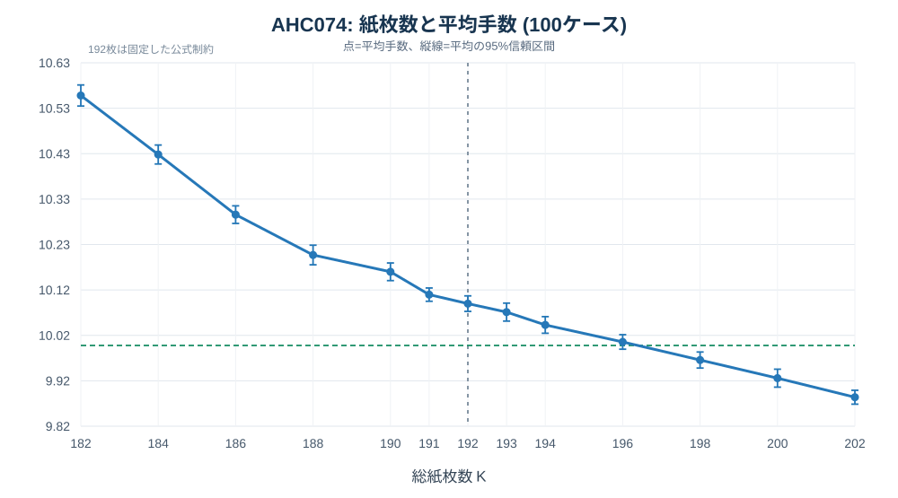
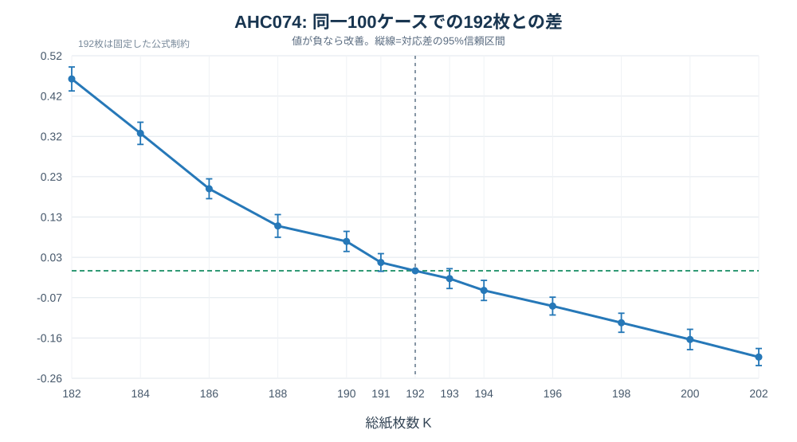

# AHC074 紙の総枚数に対する感度実験

## 結論

**元解法を変更せずに使える紙の総数だけ増減させると、192→202枚で平均手数は 10.09322 → 9.88463 手/注文となりました。改善は 0.20859 手/注文、2.067% です。** 追加10枚による削減量の95%信頼区間は [0.18796, 0.22922] 手/注文です。

逆に192→182枚では 10.55713 手/注文となり、0.46391 手/注文（4.596%）悪化しました。増枚と減枚の感度は対称ではありません。

192枚付近の7水準（188,190,191,192,193,194,196枚）を線形近似すると、**追加1枚につき 0.02503 手/注文の削減**、95%信頼区間は [0.02208, 0.02798] です。1024注文の1ケースに換算すると約 25.63 手/枚です。ただし、これは近傍全体の傾きであって、192→193の単独差そのものではありません。

全1,300ラン・1,331,200注文・13,491,597操作を独立のC++検証器で再生し、**誤り0、不正操作0、操作数上限違反0**でした。本報告の数値は制約を変更した実験結果であり、202枚版を本来の192枚制約へ提出できるという意味ではありません。9.5手/注文には、この増減範囲では達していません。

## 1. 評価条件

提供された `YAAu43G9.zip` の `tools/in/0000.txt`～`0099.txt` の100ケースを使用しました。全水準でバーコード一覧と注文列を完全に同一にし、入力先頭行のKだけを置き換えています。各ケース1024注文を最初から最後まで処理し、ウォームアップ部分も主評価に含めています。

評価したKは **182,184,186,188,190,191,192,193,194,196,198,200,202** の13水準です。各水準100ケース、合計1300ランです。測定対象を少数ケースの良否で選別したり、良い実行だけを採用したりしていません。

固定したものは、N=64、P=256、R=1024、汎用紙6枚、キャップ1枚、比較窓の初期値G=38、列数25、各探索の乱数種・目的関数・反復数・注文処理ロジックです。全1300ランで実際にG=38の設計が成功し、G=32/28への再試行や非常用設計は使われませんでした。列MDPの上限も元設定のままです。一部ケースは元の上限により24列のみMDPが適用され、残りは従来の評価法となります。これも再調整していません（各水準の25列適用ケース数は `summary.csv`）。

| 探索段階 | 設定／実測の反復数 |
|:---|---:|
| 窓割当て焼きなまし | 450,000 |
| 窓割当ての最終探索 | 133,000 |
| 紙・列の焼きなまし | 設定14,900,000、実際14,900,224（元コードの256刻み判定） |
| フィラー最適化 | 154,000 |
| 再マッチング | 4回 |

コンパイルはGCC 14.2.0、`-std=c++20 -O2 -march=native -DLOCAL_BENCH`。`LOCAL_BENCH` は操作ラベルの記録に使用し、実験用の探索パラメータ指定はしていません。CPUはAMD EPYC 9V74、CPUクォータは4コア相当で、主評価を4並列で実行しました。

元のプログラムは設計と注文処理を固定反復数で最後まで実行するため、今回も2秒の打ち切りはかけていません。表のCPU時間はユーザー時間＋システム時間です。4並列実行時の壁時計時間、CPU時間、メモリ使用量もケース別に保存しています。これらからジャッジでの2秒以内完了を保証することはできません。

## 2. 全水準の結果

平均手数は総操作数÷1024を100ケースで平均したものです。誤りE=0のため、絶対スコア `2KE+T` は全ランでTそのものです。「192枚との差」は負が改善、「改善ケース」は同じseedの192枚版よりTが小さかったケース数です。

| K | 枚数差 | 平均手数/注文 | 192枚との差 | 差の95%信頼区間 | 改善率 | 改善ケース | CPU秒/ケース |
|---:|---:|---:|---:|:---:|---:|---:|---:|
| 182 | -10 | 10.55713 | +0.46391 | [+0.43492, +0.49289] | -4.596% | 0/100 | 3.614 |
| 184 | -8 | 10.42562 | +0.33239 | [+0.30558, +0.35921] | -3.293% | 1/100 | 3.049 |
| 186 | -6 | 10.29158 | +0.19836 | [+0.17440, +0.22232] | -1.965% | 3/100 | 2.306 |
| 188 | -4 | 10.20166 | +0.10844 | [+0.08099, +0.13588] | -1.074% | 23/100 | 1.957 |
| 190 | -2 | 10.16422 | +0.07100 | [+0.04671, +0.09528] | -0.703% | 32/100 | 1.950 |
| 191 | -1 | 10.11329 | +0.02007 | [-0.00129, +0.04142] | -0.199% | 40/100 | 1.943 |
| 192 | +0 | 10.09322 | +0.00000 | [+0.00000, +0.00000] | -0.000% | 0/100 | 2.006 |
| 193 | +1 | 10.07434 | -0.01889 | [-0.04284, +0.00507] | +0.187% | 51/100 | 2.053 |
| 194 | +2 | 10.04573 | -0.04749 | [-0.07179, -0.02319] | +0.471% | 60/100 | 2.116 |
| 196 | +4 | 10.00784 | -0.08538 | [-0.10691, -0.06385] | +0.846% | 77/100 | 2.195 |
| 198 | +6 | 9.96752 | -0.12570 | [-0.14873, -0.10268] | +1.245% | 89/100 | 2.261 |
| 200 | +8 | 9.92710 | -0.16612 | [-0.19067, -0.14158] | +1.646% | 93/100 | 2.382 |
| 202 | +10 | 9.88463 | -0.20859 | [-0.22922, -0.18796] | +2.067% | 98/100 | 2.401 |

この100ケースで平均10.0手/注文未満だった測定水準は **198, 200, 202枚** です。未測定の整数水準の性能や、母集団平均が厳密に10.0を下回るかについては、この標本平均だけから断定しません。平均自体の95%信頼区間も `summary.csv` に収録しています。





## 3. 「1枚の価値」をどこまで言えるか

個別の1枚差をそのまま確定値として扱うことはできません。

- 191枚との差は、191−192 = +0.02007 手/注文、95%信頼区間 [-0.00129, +0.04142]。
- 192→193枚は -0.01889 手/注文、95%信頼区間 [-0.04284, +0.00507]。

この2つの実測値と、近傍7水準から得る約0.02503手/枚という傾きは、別の統計量です。1枚だけ増減したときにはマッチング・焼きなましの軌道が変わり、期待効果より大きいケース別変動が乗ることがあります。

| 感度の取り方 | 追加1枚による削減（手/注文） | 95%信頼区間 |
|:---|---:|:---:|
| 188～196の7水準で線形近似 | 0.02503 | [0.02208, 0.02798] |
| 192→202の10枚分を平均 | 0.02086 | [0.01880, 0.02292] |
| 182→192の10枚分を平均 | 0.04639 | [0.04349, 0.04929] |

近傍の傾きのseed単位ブートストラップ95%区間は [0.02215, 0.02794] 手/枚です。総枚数を減らした領域での平均的な損失が、増やした領域での利益より大きく、全範囲に一定の「1枚当たり価値」を当てはめるのは不適切です。評価範囲外へ直線外挿して9.5達成枚数を断定することもしていません。

### 隣接する測定水準の差

| 変更 | 平均差（手/注文） | 差の95%信頼区間 | 追加1枚当たりの差 |
|:---|---:|:---:|---:|
| 182→184 | -0.13151 | [-0.15959, -0.10343] | -0.06576 |
| 184→186 | -0.13403 | [-0.15780, -0.11027] | -0.06702 |
| 186→188 | -0.08992 | [-0.11540, -0.06445] | -0.04496 |
| 188→190 | -0.03744 | [-0.06630, -0.00858] | -0.01872 |
| 190→191 | -0.05093 | [-0.07431, -0.02754] | -0.05093 |
| 191→192 | -0.02007 | [-0.04142, +0.00129] | -0.02007 |
| 192→193 | -0.01889 | [-0.04284, +0.00507] | -0.01889 |
| 193→194 | -0.02860 | [-0.05292, -0.00428] | -0.02860 |
| 194→196 | -0.03789 | [-0.06205, -0.01373] | -0.01895 |
| 196→198 | -0.04032 | [-0.06507, -0.01558] | -0.02016 |
| 198→200 | -0.04042 | [-0.06591, -0.01493] | -0.02021 |
| 200→202 | -0.04247 | [-0.06594, -0.01900] | -0.02124 |

誤り0に限定した理論上の最小手数は、余剰紙を全穴にして最下段に置くことで元の解を再現できるため、Kを増やして悪化することはありません。一方、今回測った「同じヒューリスティックが毎回設計し直した値」は単調性を保証されません。有限ケースの微小な逆転を、そのまま「紙を減らすべき」と読むことはできません。

## 4. 増枚で何が変わるか

汎用6枚＋キャップ1枚を固定しているので、商品に割り当てる紙の数U、共有ペア数B、単独専用紙数Sは次の通りです。

```text
U = K - 7
B = 256 - U = 263 - K
S = U - B = 2K - 270
```

| K | 商品用紙U | 2目標共有紙B | 単独専用紙S |
|---:|---:|---:|---:|
| 182 | 175 | 81 | 94 |
| 192 | 185 | 71 | 114 |
| 202 | 195 | 61 | 134 |

追加1枚は、枚数の収支上「共有ペア1組を減らし、単独紙を2枚増やす」ことに相当します。ただし実装では全体を再設計するため、特定の元ペアだけを分割して他を固定する介入ではありません。

追加紙で共有による穴が減り、汎用層・ハンドル修正等の負担が下がります。その一方で、商品用紙の実枚数が増えるため、取り出す列を掘る負担は上がります。全100ケースの実際の操作を分類すると次の通りです（単位: 手/注文）。

| 手数の区分 | 182枚 | 192枚 | 202枚 | 202−192 |
|:---|---:|---:|---:|---:|
| 汎用紙の全移動（紙番号で判定） | 1.51687 | 1.24143 | 1.02079 | -0.22063 |
| 専用・共有紙の掘り出し（dig） | 2.66090 | 2.87534 | 3.06679 | +0.19145 |
| ハンドル修正（fix） | 1.95674 | 1.74274 | 1.71216 | -0.03059 |
| その他の移動 | 4.42262 | 4.23371 | 4.08489 | -0.14882 |
| 合計 | 10.55713 | 10.09322 | 9.88463 | -0.20859 |

`dig` と `fix` は元コードの操作ラベルです。汎用紙の全移動はラベルではなく実際の紙番号で数え、後処理で追加された汎用紙の移動も含めています。この2つのラベルは商品用紙の移動なので汎用紙とは重複しません。「その他」は返却・持上げ・フィラー・ヘルパー・後処理の修復などをまとめた残差で、4区分の合計は実測総手数に一致します。詳細な全ラベルは `operation_breakdown.csv` にあります。

この分類は改善の経路を示す観察値です。各部の寄与を独立に変更した実験ではないため、内訳を厳密な因果寄与分解とは呼んでいません。

## 5. 汎用紙を減らすか増やすかへの示唆

**この実験で直接分かったのは、「汎用6枚を維持したまま商品用紙の予算だけ増減させる価値」です。汎用5枚対6枚対7枚の優劣は測っていません。**

資源面の目安としては、汎用紙を1枚節約して商品用紙を1枚増やす利益は、192枚付近の傾きでおよそ0.025手/注文です。反対に、汎用紙を1枚増やすため商品用紙を1枚減らす資源コストも、この近傍では同程度が一つの目安になります。

したがって、専用紙1枚を確保するために汎用層の能力を大きく落とす方針は、今回の資源価値だけでは支持しにくいです。汎用紙を増やしてそれを上回る汎用処理・共有適合性等の改善を得られるなら、その方針を総枚数192で実測する価値があります。ただしMを変えると比較可能な関係・相性グラフ・必要手数・窓配分まで変わるため、上記の値は損益分岐の概算であり、Mの変更の正確な予測式ではありません。

基準10.09322から10.0までの差は0.09322手/注文です。「汎用を1枚削るだけ」の資源効果は、近傍の平均的な傾きではその差全体を埋めるほどではありません。元問題の目標達成には、紙の枚数収支に加え、その紙がどれだけ操作を減らす機能を持つかを評価する必要があります。

## 6. 実装上の変更と検証

変更箇所は `src/paper-count.patch` にすべて収録しています。

1. `K=192` をコンパイル時マクロ `PAPER_COUNT` に変更。既定値は192。
2. 窓割当ての必要ペア数を `P-(K-1-M)`、設計の商品の紙数を `K-1-M` に変更。
3. 後処理の紙番号／位置ビット集合を固定3ワードから `(K+63)/64` ワードへ変更し、走査ループも追随。**K>192では4ワードが必要なため、Kの定数だけの置換では安全な比較になりません。**
4. 非常用設計の移動先の固定値191を `K-1` に変更。

乱数種、目的関数、探索回数、列数の方針、オンライン手順は変えていません。`src/esw-k*.cpp` は設定用ラッパーであり、実装本体は `src/esw-paper-count.cpp` です。既定値192は元プログラムと同じ解法であり、新しい改善解として提示しているわけではありません。

元コードとK=192版を同じコンパイル条件で10ケース実行し、紙の設計と全操作列の標準出力がバイト単位で完全一致することを確認しました。さらに13水準それぞれseed 0について、最初にバーコードだけを渡し、各注文の応答後に次の注文を渡す本当の対話実行を行いました。一括入力による主評価と対話実行の出力も全13水準で完全一致しました。

独立検証器は全操作について、紙番号と挿入位置の範囲、移動直前の可視性、差込み後の順序、各注文終了時の表示、各注文2K回以内、最終余剰出力なしを検査しています。最大の1注文の手数は23手でした。さらに、サンプル・不可視紙・全穴紙・白背景・誤表示・範囲外・打切り・余分な出力など11個の検証器テストを通しています。

提供ツールのRust実装自体を実行したのではなく、その規則を読み、別実装のC++検証器で評価しました。公式の参照ソースと元ツールZIPも付属しています。保存済み全出力をハッシュ照合したうえで再度全操作を検証した結果は `validation/archive-audit.json` にあります。

## 7. 統計と結果の読み方

各seed s・枚数Kで `y[s,K]=T[s,K]/1024` とし、対応付き差 `d[s,K]=y[s,K]-y[s,192]` の100個の標本から平均とt分布による95%信頼区間を計算しています。1ケース内の1024注文は状態を引き継ぐため独立標本とは扱っていません。

表の区間は各比較ごとの点ごとの95%区間です。13水準から192枚を除いた12比較に対するBonferroni同時95%区間は `summary.csv` に別列で出力しました。20,000回のケース単位ブートストラップでも確認し、乱数種は740192です。局所傾きは各seedについて188～196枚の7水準に回帰し、その100本の傾きから集計しています。

結果はこの解法・固定探索予算・100個の生成入力に対するものであり、最適な紙構造の理論限界、別の汎用紙枚数の結果、コンテスト順位、将来の全入力での成績を保証するものではありません。100ケースで観測した平均と、そこからの推定の不確実性を分けて報告しています。

## 8. 再現と成果物

コンパイル・1ケース実行・全評価再現は `README.md` を参照してください。全結果、全操作列、stderr、入力、ソース、パッチ、検証器、再現スクリプトを同じZIPへ収録しています。実行ファイルはCPU依存のためZIPには含めず、ソースからビルドします。

主な数値ファイルは `results/summary.csv`、`results/per_case.csv`、`results/adjacent_differences.csv`、`results/operation_breakdown.csv`、`results/paired_moves_matrix.csv`、`results/statistics.json`、`results/runs.jsonl` です。検証用の出力ハッシュと入力のSHA-256も保存しました。

主評価の総CPU時間は3023.15秒です。元コードとの一致試験・対話試験・再生検証・コンパイルは、この総CPU時間には含みません。

## GitHub版の収録範囲（2026-11-07 追記）

この研究PRでは、元のレポート、K可変のC++ソース・差分・独立再生検証器、100ケースの対応比較CSV、グラフ（GitHub閲覧用SVG）、簡易再現スクリプトを管理します。既存の提出解を置き換えず、公式制約K=192も変更しません。

原実験の約45MiBのZIPアーカイブには、1,300ランの全stdout/stderr、全1024注文の操作回数、入力、ハッシュ、回帰テスト・反応型テスト記録、追加の詳細集計・分析スクリプトが含まれますが、大容量の生ログ・生操作列はこのPRに重複してコミットしません。数値の検証には、このPRの `results/per_case.csv` および `results/summary.csv` とソースを使用してください。公式入力はリポジトリ既存の `tools/in/` にあります（種0、1、9、99のGit blob SHAについて原実験との一致を確認済み）。
